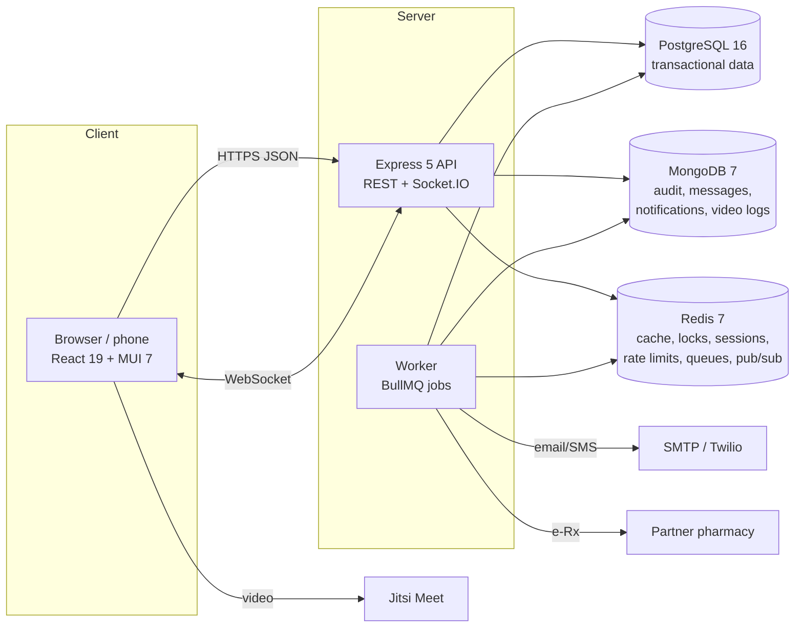

# RX Clinic Information System: Project Plan and Assessment

| | |
|---|---|
| **Project** | RX Doctor–Patient Clinic Information System (CIS) |
| **Prepared by** | IT Office, City Government of Ormoc |
| **Methodology** | Iterative SDLC (Agile Scrum, 2-week sprints) inside a phase-gated plan |
| **Version** | 1.0 |

This document follows the SDLC phases in order: planning, analysis, design, implementation, testing, deployment and maintenance. Each phase ends at a gate with named deliverables so progress can be reported to management in plain terms, while the build itself runs in short sprints so users see working software early.

---

## 1. Planning

### 1.1 Problem statement

Clinics that run on paper and spreadsheets lose time and money in predictable places. Patients queue to book, doctors cannot see a full medication list when prescribing, handwritten prescriptions are misread at the pharmacy, lab results arrive on paper and get misfiled, unpaid bills are hard to track, and stock runs out without warning. Patient data sits in cabinets with no record of who looked at it, which is a Data Privacy Act exposure.

### 1.2 Objectives

The objectives are written to be measurable so they can be checked after go-live (see section 9, KPIs).

1. Let patients book, reschedule and cancel online, with automatic reminders, to cut no-shows by at least 25% within six months.
2. Give doctors one chart per patient (allergies, medications, conditions, visit notes, prescriptions, labs) available in under 2 seconds.
3. Block unsafe prescriptions before signing: known allergies, duplicate therapy and drug–drug interactions.
4. Issue printable, legible prescriptions with PRC license, PTR and S2 numbers, and send them electronically to partner pharmacies.
5. Bill correctly, including senior citizen and PWD discounts, and accept GCash, Maya, card and cash.
6. Keep an audit trail of every access to patient records to support RA 10173 compliance.
7. Warn staff before medical supplies run out or expire.

### 1.3 Scope

**In scope (release 1.0):** patient registration and profiles; appointment scheduling with doctor clinic hours and time off; medical records (allergies, medications, conditions, encounter notes with vitals and ICD-10); e-prescribing with safety checks and a printable Rx pad; lab ordering and result entry; billing, online payments, HMO/PhilHealth claims; secure doctor–patient messaging; telemedicine video visits; inventory; reports and analytics; user management; audit logs; email/SMS notifications; two-factor authentication.

**Out of scope (candidates for later releases):** native mobile apps (the web app is responsive and works on phones), direct PhilHealth eClaims API submission, HL7/FHIR interfaces to external laboratory systems, AI-assisted diagnosis, wearable device integration, and multi-clinic tenancy. Section 7 of the overview lists these as future enhancements; the architecture leaves room for them.

### 1.4 Stakeholders and RACI

| Activity | Project Sponsor (City Health / Mayor's Office) | Project Manager (IT Office) | Developers | Clinic Doctors | Front Desk / Billing | Data Protection Officer |
|---|---|---|---|---|---|---|
| Approve scope and budget | **A** | R | C | C | I | C |
| Gather requirements | I | **A** | R | C | C | C |
| System design | I | **A** | R | C | I | C |
| Build and unit test | I | A | **R** | I | I | I |
| User acceptance testing | I | A | C | **R** | **R** | C |
| Privacy impact assessment | I | C | C | I | I | **A/R** |
| Go-live decision | **A** | R | C | C | C | C |
| Training | I | **A** | R | C | C | I |

R = responsible, A = accountable, C = consulted, I = informed.

### 1.5 Feasibility assessment

| Area | Assessment | Rating |
|---|---|---|
| **Technical** | Uses mainstream open-source tools (React, Node.js, PostgreSQL, MongoDB, Redis) that the IT Office can hire for and support. No proprietary licenses. Runs on one mid-size VM or managed cloud services. | High |
| **Operational** | Staff already use smartphones and web browsers. Workflows mirror the current paper process (booking → consult → Rx → bill), so training is short. Main risk is doctors' time to learn charting; mitigated by a focused two-hour session and quick-entry forms. | Medium–High |
| **Economic** | Software cost is zero (open source). Main costs are development effort, hosting and SMS credits. Savings come from fewer no-shows, faster billing, and fewer stock-outs. | High |
| **Legal / regulatory** | Must comply with RA 10173 (Data Privacy Act) and NPC circulars, RA 9994 and RA 10754 (senior/PWD discounts), RA 6675 (Generics Act) prescription format, and PDEA rules for dangerous drugs (S2). All are addressed in the design. | Achievable |
| **Schedule** | 24 weeks for release 1.0 with a team of 3–4 (see section 1.7). | Medium |

### 1.6 Work breakdown structure (WBS)

```
1.0 RX Clinic Information System
├── 1.1 Project management
│   ├── 1.1.1 Project charter and plan
│   ├── 1.1.2 Sprint planning and reviews
│   └── 1.1.3 Status reporting
├── 1.2 Requirements
│   ├── 1.2.1 Stakeholder interviews and clinic walkthrough
│   ├── 1.2.2 Functional and non-functional requirements
│   └── 1.2.3 Privacy impact assessment
├── 1.3 Design
│   ├── 1.3.1 Architecture and data flow (DFD Level 0/1)
│   ├── 1.3.2 Database design (docs/02-database-design.md)
│   ├── 1.3.3 API contract
│   └── 1.3.4 UI design system and wireframes
├── 1.4 Build
│   ├── 1.4.1 Platform: auth, RBAC, audit, encryption, caching
│   ├── 1.4.2 Patients and medical records
│   ├── 1.4.3 Scheduling and telemedicine
│   ├── 1.4.4 Prescriptions and drug safety engine
│   ├── 1.4.5 Labs
│   ├── 1.4.6 Billing, payments, claims
│   ├── 1.4.7 Messaging and notifications
│   ├── 1.4.8 Inventory
│   └── 1.4.9 Reports and analytics
├── 1.5 Testing
│   ├── 1.5.1 Unit and integration tests
│   ├── 1.5.2 Security testing (OWASP ASVS L2, penetration test)
│   ├── 1.5.3 Performance testing
│   └── 1.5.4 User acceptance testing
├── 1.6 Deployment
│   ├── 1.6.1 Production infrastructure and backups
│   ├── 1.6.2 Data migration (existing patient masterlist)
│   ├── 1.6.3 Training and user manuals
│   └── 1.6.4 Go-live and hypercare
└── 1.7 Maintenance
    ├── 1.7.1 Monitoring and incident response
    └── 1.7.2 Enhancement backlog
```

### 1.7 Timeline

A 24-week plan for a team of one project manager, two full-stack developers and one part-time QA/security reviewer.

```mermaid
gantt
    title RX Clinic release 1.0
    dateFormat  YYYY-MM-DD
    axisFormat  %b %d
    section Planning & Analysis
    Charter, stakeholder interviews      :a1, 2026-10-05, 14d
    Requirements, privacy impact assessment :a2, after a1, 14d
    section Design
    Architecture, DB and API design      :d1, after a2, 14d
    UI design system and wireframes      :d2, after a2, 14d
    section Build (sprints)
    S1 Platform: auth, RBAC, audit       :b1, after d1, 14d
    S2 Patients, records, scheduling     :b2, after b1, 14d
    S3 Prescriptions, labs               :b3, after b2, 14d
    S4 Billing, payments, claims         :b4, after b3, 14d
    S5 Messaging, telemedicine, inventory:b5, after b4, 14d
    S6 Reports, hardening                :b6, after b5, 14d
    section Testing
    Security and performance testing    :t1, after b5, 21d
    User acceptance testing              :t2, after b6, 14d
    section Deployment
    Training, data migration             :g1, after t2, 7d
    Go-live and hypercare                :milestone, g2, after g1, 0d
```

**Milestones and gates**

| Gate | Week | Exit criteria |
|---|---|---|
| G1 Plan approved | 2 | Charter signed by sponsor |
| G2 Requirements baselined | 4 | FR/NFR list signed off by doctors and front desk; PIA reviewed by DPO |
| G3 Design approved | 6 | Architecture, ERD and API contract reviewed |
| G4 Feature complete | 18 | All in-scope features demoed at sprint reviews |
| G5 Ready for production | 22 | No open critical/high security findings; UAT passed; backups tested |
| G6 Go-live | 24 | Training done; hypercare rota in place |

---

## 2. Analysis: Requirements

### 2.1 Functional requirements

| ID | Requirement | Role | Priority |
|---|---|---|---|
| FR-01 | Register an account with name, birth date, sex, mobile number, email and consent | Patient | Must |
| FR-02 | Update contact details, address, emergency contact, blood type, insurance cards | Patient | Must |
| FR-03 | View open time slots per doctor and date; book in-person or video visits | Patient, Front desk | Must |
| FR-04 | Reschedule or cancel an upcoming appointment | Patient, Front desk | Must |
| FR-05 | Receive booking confirmation and a 24-hour reminder by email/SMS | Patient | Must |
| FR-06 | View visit notes, prescriptions and lab results | Patient | Must |
| FR-07 | Record allergies and current medications | Patient, Doctor | Must |
| FR-08 | Dashboard of today's visits, waiting patients and pending labs | Doctor | Must |
| FR-09 | Write consultation notes with vitals and ICD-10 diagnoses | Doctor | Must |
| FR-10 | Write e-prescriptions with allergy, duplicate and interaction alerts; override requires a written reason | Doctor | Must |
| FR-11 | Print or save a prescription as PDF with PRC/PTR/S2 details | Doctor, Patient | Must |
| FR-12 | Send prescriptions to a partner pharmacy | Doctor | Should |
| FR-13 | Order lab tests; enter results; notify patient and doctor | Doctor, Admin | Must |
| FR-14 | Issue invoices with senior/PWD discount; record payments; pay online | Front desk, Patient | Must |
| FR-15 | File HMO/PhilHealth claims and record approvals | Front desk | Should |
| FR-16 | Secure messaging between a patient and their doctor | Patient, Doctor | Should |
| FR-17 | Video consultation limited to the appointment window | Patient, Doctor | Should |
| FR-18 | Maintain inventory with a stock movement ledger, reorder and expiry alerts | Front desk, Admin | Must |
| FR-19 | Reports: visits, no-show rate, collections, receivables, top diagnoses | Admin, Doctor | Must |
| FR-20 | Create, deactivate and reactivate staff accounts | Admin | Must |
| FR-21 | View an audit log filterable by patient | Admin, DPO | Must |
| FR-22 | Set weekly clinic hours and block time off | Doctor | Must |

### 2.2 Non-functional requirements

| ID | Category | Requirement | How the design meets it |
|---|---|---|---|
| NFR-01 | Security | Passwords hashed with bcrypt; login lockout after 5 failures for 15 minutes | `auth.service.js`, Redis counter |
| NFR-02 | Security | Short-lived access tokens (15 min) in memory; refresh token in an httpOnly, SameSite=Strict cookie with rotation and reuse detection | `auth.routes.js`, `http.js` |
| NFR-03 | Security | Two-factor authentication (TOTP) available to all, expected for staff | `otplib`, Settings page |
| NFR-04 | Security | Role-based access control on every endpoint; doctors see only patients with a care relationship; front desk cannot open clinical data | `middleware/auth.js` |
| NFR-05 | Privacy | Clinical notes, messages, MFA secrets and insurance member numbers encrypted at rest with AES-256-GCM | `utils/crypto.js` |
| NFR-06 | Privacy | Every view or change of patient data logged with who, what, when and IP | `middleware/audit.js`, MongoDB `auditlogs` |
| NFR-07 | Integrity | No double-booking, even under concurrent requests | Redis lock + PostgreSQL `EXCLUDE` constraint |
| NFR-08 | Integrity | Money calculated in integer centavos; invoice balance maintained by a database trigger; payments idempotent | `totals.js`, `sync_invoice_payment` trigger |
| NFR-09 | Performance | 95th percentile API response under 300 ms for 100 concurrent users | Indexes, Redis caching, materialized views |
| NFR-10 | Availability | 99.5% monthly uptime during clinic hours; RPO 1 hour, RTO 4 hours | Backups (section 6.3) |
| NFR-11 | Usability | Works on phones from 360 px wide; keyboard accessible; WCAG 2.1 AA contrast | MUI, responsive layout, focus styles |
| NFR-12 | Maintainability | Modular code by feature; pure functions for business rules with unit tests | `modules/*`, `tests/*` |

### 2.3 Data flow

The Level 0 and Level 1 DFDs in the project folder describe the external entities (Patient, Doctor, Admin/Staff, Pharmacy/Lab, Telemedicine Platform) and the processes. Each Level 1 process maps to one backend module:

| DFD process | Backend module | Primary data store |
|---|---|---|
| Appointment Management | `modules/appointments`, `modules/doctors` | PostgreSQL `appointments`, `doctor_schedules` |
| Medical Records Management | `modules/records`, `modules/patients` | PostgreSQL `patients`, `encounters`, `allergies`… |
| Prescription Management | `modules/prescriptions` | PostgreSQL `prescriptions`, `drugs`, `drug_interactions` |
| Lab/Diagnostic Orders | `modules/labs` | PostgreSQL `lab_orders`, `lab_order_items` |
| Billing & Payment | `modules/billing` | PostgreSQL `invoices`, `payments`, `insurance_claims` |
| Inventory Management | `modules/inventory` | PostgreSQL `inventory_items`, `inventory_transactions` |
| Reporting & Analytics | `modules/reports` | PostgreSQL materialized views + Redis cache |
| Telemedicine Platform | `modules/telemedicine` | MongoDB `telemedicinesessions` + Jitsi |
| (Communication) | `modules/messages`, `modules/notifications` | MongoDB `conversations`, `messages`, `notifications` |

---

## 3. Design

### 3.1 Architecture



**Why this shape**

- **Modular monolith, not microservices.** One API process organized by feature module. A clinic's load does not justify the operational cost of many services, and a modular layout can be split later along the same module boundaries if multi-clinic support is added.
- **Separate worker process.** Emails, SMS, reminders, pharmacy transmission and analytics refreshes run in BullMQ jobs, so a slow SMS gateway never slows down a doctor saving a note. Jobs retry with backoff.
- **Polyglot persistence.** Each store does what it is best at (full rationale in `02-database-design.md`).
- **Real-time through Redis pub/sub.** Any process publishes an event; the API's Socket.IO layer pushes it to the right user's browser. This keeps working if the API is scaled to several instances.

### 3.2 Technology stack

| Layer | Choice | Reason |
|---|---|---|
| Frontend | React 19, Vite 6, MUI 7, TanStack Query 5, React Router 7 | Required stack; Query handles caching, retries and cache invalidation |
| Charts | Recharts | Declarative, small learning curve |
| Backend | Node.js 20+, Express 5 | Required stack; Express 5 forwards async errors natively |
| Validation | Zod | One schema validates input and documents the API |
| Relational DB | PostgreSQL 16 | Constraints, triggers, exclusion constraints, JSONB, trigram search, materialized views |
| Document DB | MongoDB 7 (Mongoose) | Append-heavy logs and chat with flexible shape |
| Cache/queue | Redis 7, BullMQ | Caching, distributed locks, rate limiting, job queue, pub/sub |
| Video | Jitsi Meet (self-hostable) | Free, no per-minute cost, can be hosted on government servers |
| Payments | Gateway adapter (mock in development; PayMongo or Xendit in production) | Local e-wallets (GCash, Maya) |
| DevOps | Docker Compose (dev), GitHub Actions, Nginx | Simple, reproducible |

### 3.3 Security design

| Threat (OWASP Top 10) | Control |
|---|---|
| A01 Broken access control | `authorize(role)` on routes plus `assertPatientAccess` row-level checks; UI hides what the API would refuse anyway |
| A02 Cryptographic failures | TLS in transit; AES-256-GCM for sensitive fields; bcrypt cost 12 for passwords |
| A03 Injection | Parameterized SQL only (`$1` placeholders); Mongoose schemas; Zod validation on every input |
| A04 Insecure design | Drug-safety engine and double-booking guard enforced server-side and in the database |
| A05 Security misconfiguration | Helmet headers, strict CORS origin, JSON body size limit, environment validation at startup |
| A07 Authentication failures | Lockout, rate limiting, TOTP 2FA, refresh-token rotation with reuse detection |
| A08 Integrity failures | Idempotency keys on payments; append-only inventory ledger |
| A09 Logging failures | Audit log for every patient-data access; pino logs with sensitive fields redacted |
| XSS / CSRF | React escapes output; access token never in localStorage; refresh cookie is httpOnly and SameSite=Strict |

---

## 4. Implementation

- **Repository layout**: `server/` (API and worker), `client/` (React app), `docs/`, `docker-compose.yml`, `.vscode/`.
- **Coding standards**: ES modules, Prettier formatting, one folder per feature module, pure functions for business rules (`availability.js`, `safety.js`, `totals.js`) so they can be unit tested without a database.
- **Branching**: `main` (production), `develop` (integration), short-lived `feature/*` branches merged by pull request with one reviewer.
- **Definition of done**: code reviewed, tests pass, no new lint errors, API change reflected in `api.http`, audit logging added for any new patient-data endpoint.

## 5. Testing strategy

| Level | What | Tool | Status in this repository |
|---|---|---|---|
| Unit | Slot generation, drug safety rules, invoice math, encryption | `node --test` | 13 tests passing (`npm test`) |
| Integration / API | Full flows against real PostgreSQL and Redis: login and lockout, booking and race conditions, RBAC denials, encrypted notes, Rx safety block, lab results, senior discount billing, idempotent payment, inventory overdraw, reports, refresh-token reuse | Scripted end-to-end run | Passed during development |
| Security | OWASP ASVS Level 2 checklist, dependency audit (`npm audit`), external penetration test before go-live | ZAP, npm audit | Planned (G5) |
| Performance | 100 concurrent users on booking, chart load and reports | k6 | Planned |
| UAT | Scripted scenarios run by two doctors and two front-desk staff for one week on a copy of real schedules | Test scripts | Planned (G5) |

**Sample UAT scenarios**

1. Patient books a video visit for tomorrow, receives confirmation, reschedules, and joins at the scheduled time.
2. Doctor opens a chart for a patient allergic to penicillin, tries to prescribe amoxicillin, sees the block, and either changes the drug or documents an override.
3. Front desk bills a senior citizen ₱1,100 and the invoice shows ₱880 with no VAT.
4. Patient pays ₱500 by GCash; the network drops; the patient taps Pay again; only one ₱500 payment is recorded.
5. Admin filters the audit log by a patient and can list everyone who viewed that chart.

## 6. Deployment

### 6.1 Environments

| Environment | Purpose | Data |
|---|---|---|
| Local | Development in VSCode with Docker Compose | Seed data |
| Staging | UAT and training | Anonymized copy |
| Production | Live clinic | Real patient data |

### 6.2 Production setup

1. Ubuntu 24.04 VM (4 vCPU, 8 GB RAM, 100 GB SSD) or managed services: PostgreSQL, MongoDB Atlas and Redis.
2. Nginx as reverse proxy with TLS (Let's Encrypt), serving `client/dist` and proxying `/api` and `/socket.io` to the API.
3. API and worker run as separate systemd services or containers with `NODE_ENV=production`.
4. Secrets (JWT keys, `ENCRYPTION_KEY`) stored outside the repository and rotated yearly. The encryption key must also be backed up securely: without it, encrypted notes cannot be read.
5. CI/CD on GitHub Actions: install, test, build the client, then deploy on tag.

### 6.3 Backup and recovery

| Store | Method | Frequency | Retention |
|---|---|---|---|
| PostgreSQL | WAL archiving + nightly `pg_dump` | Continuous + daily | 30 days |
| MongoDB | `mongodump` | Nightly | 30 days (audit logs archived for 5 years) |
| Redis | AOF persistence | Continuous | Not a system of record; rebuildable |

A restore drill is run every quarter to prove the RPO (1 hour) and RTO (4 hours).

## 7. Maintenance

- **Monitoring**: `/api/health`, process metrics (Prometheus/Grafana optional), alerts on error-rate spikes, failed jobs and disk use.
- **Patching**: monthly dependency updates; urgent security patches within 72 hours.
- **Support**: hypercare for two weeks after go-live, then an issue tracker triaged weekly.
- **Enhancement backlog**: PhilHealth eClaims integration, FHIR export, native mobile app, multi-clinic tenancy, patient health trend charts.

---

## 8. Risk assessment

Likelihood and impact are scored 1 (low) to 5 (high); score = L × I. Scores of 12 and above are reviewed at every sprint review.

| # | Risk | L | I | Score | Mitigation | Owner |
|---|---|---|---|---|---|---|
| R1 | Data breach exposing patient records | 2 | 5 | **10** | Encryption at rest, RBAC, 2FA for staff, audit log, penetration test before go-live, least-privilege DB user | PM / DPO |
| R2 | Low adoption by doctors (charting feels slow) | 3 | 4 | **12** | Involve doctors in design; quick-entry forms; training; measure note completion weekly | PM |
| R3 | Scope creep from new feature requests | 4 | 3 | **12** | Change requests go to the backlog and are approved by the sponsor at gates | PM |
| R4 | Unreliable internet at the clinic | 3 | 4 | **12** | Lightweight pages, LTE backup router, paper downtime forms with later entry | IT Office |
| R5 | Loss of the encryption key | 1 | 5 | 5 | Key stored in a secrets manager plus a sealed offline copy held by the DPO | IT Office |
| R6 | Payment gateway or SMS provider outage | 3 | 2 | 6 | Adapter pattern allows switching providers; cash payments still recorded; jobs retry | Developers |
| R7 | Wrong drug-interaction data leads to a missed alert | 2 | 5 | **10** | Drug table maintained by a pharmacist; alerts support but never replace clinical judgment; overrides logged | Clinic head |
| R8 | Key developer leaves mid-project | 2 | 4 | 8 | Code reviews, documentation, pair programming on core modules | PM |
| R9 | Non-compliance with RA 10173 | 2 | 5 | **10** | Privacy impact assessment, NPC registration, consent capture, access request process via audit log | DPO |
| R10 | Data migration errors from existing records | 3 | 3 | 9 | Dry-run migration on staging; reconciliation report signed by clinic staff | Developers |

## 9. Compliance: Data Privacy Act of 2012 (RA 10173)

| Requirement | Implementation |
|---|---|
| Lawful basis and consent | Consent checkbox at registration linked to a privacy notice; walk-ins sign a paper consent kept on file |
| Proportionality / data minimization | Front desk cannot open clinical data; insurance lists show only the last 4 digits of member numbers |
| Security of sensitive personal information | AES-256-GCM encryption, TLS, access controls, 2FA |
| Right to access | Patients see their own records online; the audit log answers "who accessed my data" |
| Right to rectification | Patients update their own contact data; clinical corrections go through the doctor |
| Breach management | Audit logs and alerts support investigation; 72-hour NPC notification procedure documented |
| Retention | Medical records kept per DOH guidance; audit logs archived for 5 years |
| Registration | Register the data processing system with the National Privacy Commission; appoint a DPO |

## 10. Key performance indicators

| KPI | Baseline (measure before go-live) | Target at 6 months |
|---|---|---|
| No-show rate | Measure | −25% |
| Online share of bookings | 0% | 50% |
| Time from arrival to consultation | Measure | −20% |
| Prescriptions with a safety alert overridden without a reason | n/a | 0 |
| Days sales outstanding (receivables) | Measure | −30% |
| Stock-outs of tracked supplies per month | Measure | −50% |
| API p95 response time | n/a | < 300 ms |
| Monthly uptime in clinic hours | n/a | ≥ 99.5% |

## 11. Budget outline (indicative)

| Item | Basis | Notes |
|---|---|---|
| Development team | 4 people × 6 months | Largest cost; can use existing IT Office staff |
| Hosting | 1 VM or managed DBs | Government cloud or local data center |
| SMS credits | Per message | Reminders and confirmations only |
| Payment gateway fees | Per transaction | Charged by the provider on online payments |
| Penetration test | One-off before go-live | External vendor recommended |
| Training | 2 sessions per role | Uses staging environment |

Actual peso amounts depend on procurement rules (RA 12009, the New Government Procurement Act) and are filled in by the project manager.
