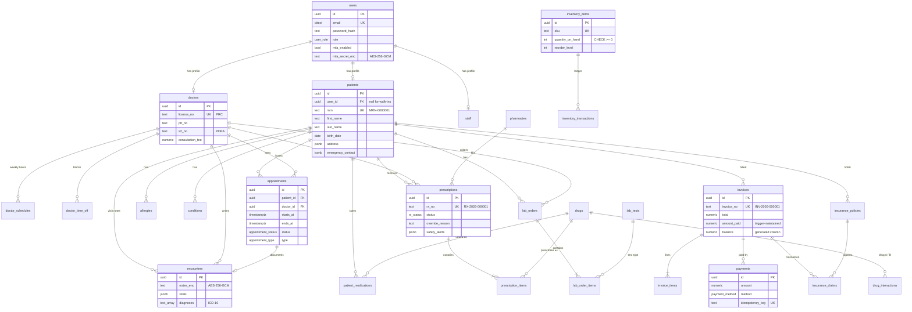

# RX Clinic: Database Design

The system uses three data stores, each chosen for the job it does best. The schema itself lives in `server/src/db/migrations/` (PostgreSQL) and `server/src/models/` (MongoDB); this document explains the reasoning.

## 1. Why three databases

| Store | Holds | Why this store |
|---|---|---|
| **PostgreSQL 16** | Patients, doctors, schedules, appointments, clinical records, prescriptions, labs, billing, inventory | Data with strong relationships and rules that must never be broken: no double-booking, balances that always match payments, stock that never goes negative. PostgreSQL enforces these with constraints, triggers and ACID transactions, so a bug in application code cannot corrupt them. |
| **MongoDB 7** | Audit logs, chat messages, notifications, telemedicine session logs | High-volume, append-mostly records whose shape varies and which are rarely joined. Keeping them out of PostgreSQL stops the audit log (one row per request) from bloating the clinical database and its backups. |
| **Redis 7** | Caches, distributed locks, refresh-token allow-list, login lockout counters, rate limits, job queue, real-time pub/sub | Sub-millisecond, in-memory operations with automatic expiry. Nothing in Redis is the only copy of important data; if it is wiped, the system rebuilds caches and users simply sign in again. |

## 2. PostgreSQL schema

### 2.1 Entity–relationship diagram

### 2.2 Design decisions

**Users separated from profiles.** `users` holds only login data (email, password hash, role, MFA). Clinical and professional details live in `patients`, `doctors` or `staff`. A walk-in patient can therefore exist without a login (`patients.user_id` is nullable) and later claim an account, and login data never mixes with medical data.

**UUID primary keys.** IDs appear in URLs; UUIDs cannot be guessed or enumerated (`/patients/1`, `/patients/2`…), which removes a whole class of access-control probing. Human-readable numbers (MRN, Rx number, invoice number) come from sequences in separate unique columns.

**Enums for fixed vocabularies.** Status and type columns (`appointment_status`, `payment_method`…) are PostgreSQL enums: invalid values are rejected by the database, and each value takes 4 bytes.

**JSONB only where the shape is genuinely loose.** Address, emergency contact and vitals are JSONB because they are always read as a whole and never queried by a sub-field in a hot path. Everything that is filtered, joined or summed is a real column.

**Money as `numeric(12,2)`**, never floating point. The application also computes totals in integer centavos (`billing/totals.js`).

### 2.3 Integrity enforced by the database

These rules hold even if the application has a bug or someone runs SQL by hand.

| Rule | Mechanism |
|---|---|
| A doctor cannot have two overlapping active appointments | `EXCLUDE USING gist (doctor_id WITH =, tstzrange(starts_at, ends_at) WITH &&) WHERE status IN (active statuses)` |
| A patient cannot be double-booked either | Same pattern on `patient_id` |
| Time-off periods cannot overlap for one doctor | `EXCLUDE` on `doctor_time_off` |
| Invoice `amount_paid` and `status` always match the payments | Trigger `sync_invoice_payment` recalculates after every payment insert or update |
| `balance` is always `total − amount_paid` | Generated column (`GENERATED ALWAYS AS … STORED`) |
| Line totals are always `quantity × unit_price` | Generated column on `invoice_items` |
| The same payment request is never recorded twice | Unique `payments.idempotency_key` |
| Stock never goes below zero | `CHECK (quantity_on_hand >= 0)` + trigger `apply_inventory_txn` that applies each ledger row |
| One primary insurance policy per patient | Partial unique index `WHERE is_primary` |
| A drug interaction pair is stored once | `CHECK (drug_a_id < drug_b_id)` + primary key on the pair |
| No duplicate allergy for a patient | Unique index on `(patient_id, lower(substance))` |

Why both a Redis lock and the exclusion constraint for booking? The Redis `SET NX` lock gives a fast, friendly "someone is booking this slot right now" message when two people click at once. The exclusion constraint is the actual guarantee; if Redis were bypassed or down, the database still refuses the second booking (the API maps PostgreSQL error `23P01` to HTTP 409).

### 2.4 Index strategy

Every index exists for a specific query. Indexes that serve no query cost write speed and disk, so none were added speculatively.

| Index | Serves |
|---|---|
| `idx_patients_name_trgm` (GIN, trigram) | Patient search with `ILIKE '%dela cruz%'`; a normal B-tree cannot help a leading wildcard |
| `idx_patients_phone` | Front desk lookup by mobile number |
| `idx_drugs_name_trgm` (GIN, trigram) | Drug autocomplete while prescribing |
| `idx_appt_doctor_time (doctor_id, starts_at)` | Slot generation and the doctor's day view |
| `idx_appt_patient_time (patient_id, starts_at DESC)` | A patient's appointment list, newest first |
| `idx_appt_care_rel (doctor_id, patient_id)` | Care-relationship check run on every chart access |
| `idx_appt_upcoming` (partial: scheduled/confirmed) | Reminder scans; small because past and cancelled rows are excluded |
| `idx_meds_active` (partial: `ended_on IS NULL`) | Drug safety check reads only current medications |
| `idx_encounters_diag` (GIN on `text[]`) | "Top diagnoses" report |
| `idx_lab_orders_open` (partial) | Lab work queue |
| `idx_invoices_unpaid` (partial) | Receivables and overdue lists |
| `idx_payments_paid_at` (partial: succeeded) | Revenue reports |
| `idx_inventory_low` (partial: at or below reorder level) | Low-stock alerts; usually only a handful of rows |
| `idx_users_role_active` (partial) | Admin user lists by role |

Partial indexes are used heavily because clinic queries almost always target the "live" subset (upcoming, unpaid, active, low stock). Indexing only that subset keeps the indexes small enough to stay in memory.

### 2.5 Reporting layer

Dashboards read two materialized views instead of scanning the transactional tables:

| View | Grain | Refreshed |
|---|---|---|
| `mv_daily_appointments` | One row per day per doctor with total, completed, cancelled, no-show and telemedicine counts | Every 15 minutes by the worker, and on demand by an admin |
| `mv_daily_revenue` | One row per day per payment method with amount and count | Same |

Both have unique indexes so they can be refreshed with `REFRESH MATERIALIZED VIEW CONCURRENTLY`, which does not block readers. Report results are then cached in Redis for 5 minutes. A year of daily rows is a few thousand records, so reports stay fast however large the appointment and payment tables grow.

### 2.6 Encryption at rest

Application-level AES-256-GCM (`server/src/utils/crypto.js`) is applied to the most sensitive fields in addition to disk encryption:

| Field | Reason |
|---|---|
| `encounters.notes_enc` | Free-text clinical notes |
| `users.mfa_secret_enc` | A leaked TOTP secret defeats 2FA |
| `insurance_policies.member_no_enc` | Government-issued identifier; only `member_no_last4` is shown in lists |
| MongoDB `messages.bodyEnc` | Private doctor–patient conversations |

Ciphertexts carry a version prefix (`v1:`) so the key can be rotated later without ambiguity. GCM also authenticates the data: a tampered ciphertext fails to decrypt rather than returning garbage.

## 3. MongoDB collections

| Collection | Document shape | Indexes | Notes |
|---|---|---|---|
| `auditlogs` | `actor {id, role, name}`, `action`, `resource`, `resourceId`, `patientId`, `method`, `path`, `ip`, `userAgent`, `at` | `{patientId, at:-1}`, `{actor.id, at:-1}`, `{resource, at:-1}` | Written after each response; answers "who accessed this patient's record?" |
| `conversations` | `key` (sorted user ids), `participants [{userId, name, role}]`, `lastMessage`, `unread {userId: count}` | `key` unique, `{participants.userId, lastMessage.at:-1}` | Participant names are denormalized so the inbox renders with no joins |
| `messages` | `conversationId`, `from`, `bodyEnc`, `readAt`, `createdAt` | `{conversationId, createdAt:-1}` | Cursor pagination by `createdAt` (stable as a thread grows, unlike skip/offset) |
| `notifications` | `userId`, `type`, `title`, `body`, `link`, `channels`, `readAt`, `createdAt` | `{userId, createdAt:-1}`, TTL on `createdAt` (90 days) | Old notifications delete themselves |
| `telemedicinesessions` | `appointmentId`, `roomName`, `provider`, `events [{userId, role, type, at}]`, `startedAt`, `endedAt` | `appointmentId` unique | Join/leave log for each video visit |

IDs that point back to PostgreSQL (user, patient, appointment) are stored as strings; there are no cross-database joins in request paths.

## 4. Redis key map

| Key pattern | Type | TTL | Purpose |
|---|---|---|---|
| `cache:doctors` | string (JSON) | 5 min | Doctor directory |
| `cache:slots:{doctorId}:{date}` | string (JSON) | 60 s | Computed open slots; invalidated on any booking change for that doctor and day |
| `cache:drugs:{query}` | string (JSON) | 1 hour | Drug autocomplete |
| `cache:lab-tests` | string (JSON) | 1 hour | Lab test catalog |
| `cache:report:{scope}:{from}:{to}` | string (JSON) | 300 s | Report results; `scope` is `clinic` or a doctor id; cleared on refresh and on payments |
| `cache:care:{doctorId}:{patientId}` | string | 300 s | Cached "this doctor has a care relationship with this patient" |
| `lock:slot:{doctorId}:{startISO}` | string | 5 s | Booking lock (`SET NX PX`) |
| `rt:{userId}:{jti}` | string | 7 days | Refresh-token allow-list; deleting all `rt:{userId}:*` signs a user out everywhere |
| `login:fail:{email}` | counter | 15 min | Failed-login counter for lockout after 5 attempts |
| `mfa:pending:{userId}` | string | 10 min | TOTP secret during enrolment, before it is confirmed |
| `alert:lowstock:{itemId}` | string | 24 hours | De-duplicates low-stock alerts |
| `rl:api:*`, `rl:auth:*` | counters | window | Rate limits (300/min per client on the API, 20 per 15 min on auth) |
| `bull:clinic-jobs:*` | BullMQ structures | managed | Background job queue |
| channel `realtime:events` | pub/sub | n/a | Events fanned out to connected browsers via Socket.IO |

Cache invalidation follows one rule: the code path that changes data deletes the affected keys in the same request (`invalidate` / `invalidatePattern` in `utils/cache.js`). TTLs are a safety net, not the main mechanism.

## 5. Growth and scaling notes

- **Read scaling**: add a PostgreSQL read replica for reports; the materialized views already isolate analytics from transactional load.
- **Audit log growth**: at roughly 1 KB per entry and a few thousand requests per clinic day, the audit collection grows by about 1 GB per year. Archive entries older than one year to cold storage and keep them for 5 years.
- **Multi-clinic**: add a `clinic_id` column to tenant-owned tables and include it as the leading column of the composite indexes above; row-level security can then enforce tenant isolation in the database.
- **Partitioning**: if `appointments` or `payments` exceed tens of millions of rows, partition by month on `starts_at` / `paid_at`. Not needed at single-clinic volume.
